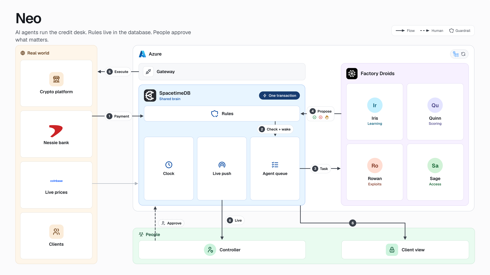
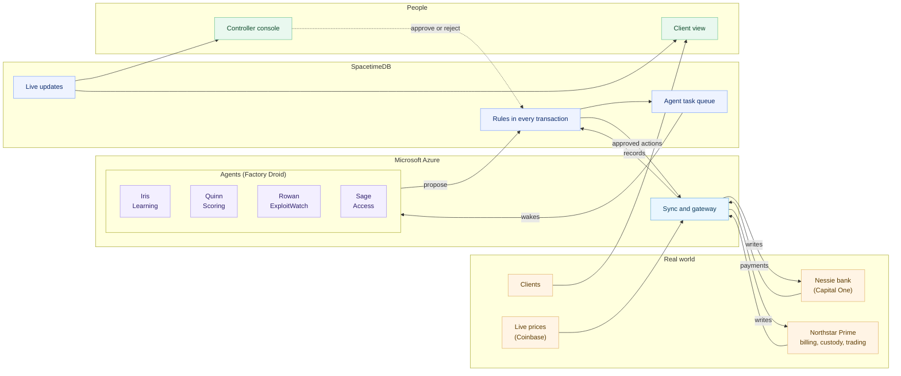

# Neo

Neo runs the credit and access desk of a crypto platform. When a client pays, pays late, pays in part or stops paying, Neo works out what is owed, collects it, restricts access only as far as the contract allows, and gives access back the moment the client is current. Four agents do the work. The database enforces the rules. A person decides only what should not be left to software.

Built for Cal Hacks 13.0 on a fictional platform, Northstar Prime, with 30 institutional clients and real money movements through Capital One's Nessie sandbox bank.

## What it does

- **Matches every payment.** Wires, ACH, USDC and partial payments are matched to invoices, including payments sent by an affiliate, short international wires, duplicates and returns.
- **Collects what is overdue.** It debits custody where the contract allows, sends notices, and runs cure periods by the contract's dates.
- **Restricts carefully.** One access setting, one step at a time, never more than is owed, never before the cure period ends, and never close-only on a hedged book.
- **Restores automatically.** When the client pays, holds are released and access returns in the same transaction.
- **Spots clients gaming the terms.** For example, paying only the day before a restriction, or using small partial payments to reset the clock.
- **Keeps the books honest.** Every sync is tied out against the bank. When something does not tie, Iris traces it to the payments that caused it and posts a correcting entry on her own if it closes the gap to the cent. Money from an unknown sender is matched to its owner or sent back after five days.
- **Learns.** Every decision a person makes becomes a precedent the agents read. Every policy the agents propose carries its own success test, checked against real payments. A policy that fails is replaced by a better one.
- **Asks a person only when it should.** Restricting a top client, promoting a client into Tier 1, offboarding, a policy that changes the contract or moves money, or when the model goes further than the rules without being sure. Reminder-only policies apply on their own. A proposal nobody decides in 10 business days is withdrawn and the agent decides again on fresh numbers.

## How it works



<details>
<summary>The same diagram as text</summary>



</details>

1. A payment lands at the bank. Sync records it in SpacetimeDB.
2. In one transaction the database matches it, applies it, releases holds if the client is now current, writes the audit row, and queues a task for each agent that should look.
3. The task is pushed to the agents. No polling, no orchestrator.
4. The agent decides and proposes through a reducer. The reducer checks the contract and policy: the action goes through, is refused and logged, or waits for a person.
5. The gateway carries approved actions to the bank and the platform. It is the only writer to systems of record.
6. Every screen updates live.

## The agents

| Agent | Job | Woken by |
|---|---|---|
| Iris, Learning | Keeps each client's credit profile current, grades the client's own policies against new payments, and looks after the books | New client, payment, dispute, a person's rejection, a books break, unidentified cash, each business day |
| Quinn, Scoring | Turns the profile into a tier and proposes tier changes or client policies | Iris moving a profile, a client policy failing |
| Rowan, ExploitWatch | Finds clients gaming the payment terms | Payment, return, dispute, deadline, withdrawal |
| Sage, Access | Collects, holds, restricts and restores, one step at a time | Payment, return, deadline, RM note, tier change, exploit flag, each business day |

Each agent handles one client per task, several clients in parallel. When Sage or Rowan has a real decision to make, a Droid session reads the client through tools (overview, invoices, payments, history, similar cases at other clients) and acts through the same guarded reducers. Quinn asks Droid for tier and policy decisions. Routine cases run on rules in milliseconds, and the rules take over if the model times out or is refused. See [agents](docs/agents.md).

## Guardrails live in the database

Agents act through the same reducers as people, so their proposals face the same checks inside the transaction: contract clauses, the platform's capabilities, policy, the amount owed, cure periods, hedged positions, payments still in transit, and who may approve what. A refused action is recorded and shown with what the agent did instead. Nobody approves their own proposal, and only the gateway writes to the bank and the platform.

## The platform runs on its own

The hosted server keeps Northstar Prime alive. A business day passes every 15 minutes. Billing issues invoices each month. Clients behave like themselves: most pay on time, some pay late or in part, one games the terms, a few are chronically late, and now and then a wire is short, duplicated or returned. Clients also withdraw and trade at live prices. Everything goes through the real paths, so you can step in at any moment as the controller, Maya Chen: approve, reject, pay, trade or change a client by hand. Her changes apply at once and the desk carries on from there. See [world](docs/world.md).

## Built with

| | Used for |
|---|---|
| [SpacetimeDB](https://spacetimedb.com) | The shared state: reducers hold the rules, the task queue wakes the agents, subscriptions push every change, a scheduled reducer runs the business clock. [Why SpacetimeDB](docs/spacetimedb.md) |
| [Factory Droid](https://factory.ai) | The agents' reasoning, with tools served over MCP |
| [Capital One Nessie](http://api.nessieisreal.com) | Bank accounts, wires, ACH, refunds and withdrawals |
| [Microsoft Azure](https://azure.microsoft.com/products/container-apps) | Container Apps for the API server and the agents, deployed by GitHub Actions |
| React and Vite | The controller console and the client view, on Vercel |

## Run it

Node 22+, pnpm, and the `spacetime` CLI for schema changes.

```bash
pnpm install
cp .env.example .env     # the shared database and hosted API (ask the team for values)
pnpm dev                 # the console on :5173, talking to the hosted API and database
```

The API server and the agents run once, on Azure, because they write to the shared database. The server refuses to start locally unless `SERVER_HOST=true`, and the agents unless `AGENTS_HOST=true`. To see what one agent would do for one client, without writing anything:

```bash
pnpm agents:try access ORG-90355
```

Every push to `main` is typechecked and tested, then built and deployed by CI.

| Command | |
|---|---|
| `pnpm typecheck` · `pnpm test` | Checks |
| `pnpm stdb:publish` · `pnpm stdb:generate` | Publish the module, regenerate bindings |
| `pnpm demo:reset` | Bank, database and hosted server back to the first morning |
| `pnpm agents:try <agent> <client>` | One agent on one client, no writes |
| `pnpm --filter @access-desk/server world:plan` | The next events the platform would produce, no writes |
| `pnpm sync:verify` · `payments:verify` · `ledger:verify` · `tieout:verify` | Check the database against its sources |

## Repository

```
spacetime/   SpacetimeDB module: tables, reducers, guardrails, task queue, audit
server/      sync, gateway, simulated platform, Nessie bank, the living platform
agents/      the four agents and their dispatcher
web/         controller console and client view
docs/        how each part works
```

## Docs

[agents](docs/agents.md) · [money](docs/money.md) · [SpacetimeDB](docs/spacetimedb.md) · [the living platform](docs/world.md)
